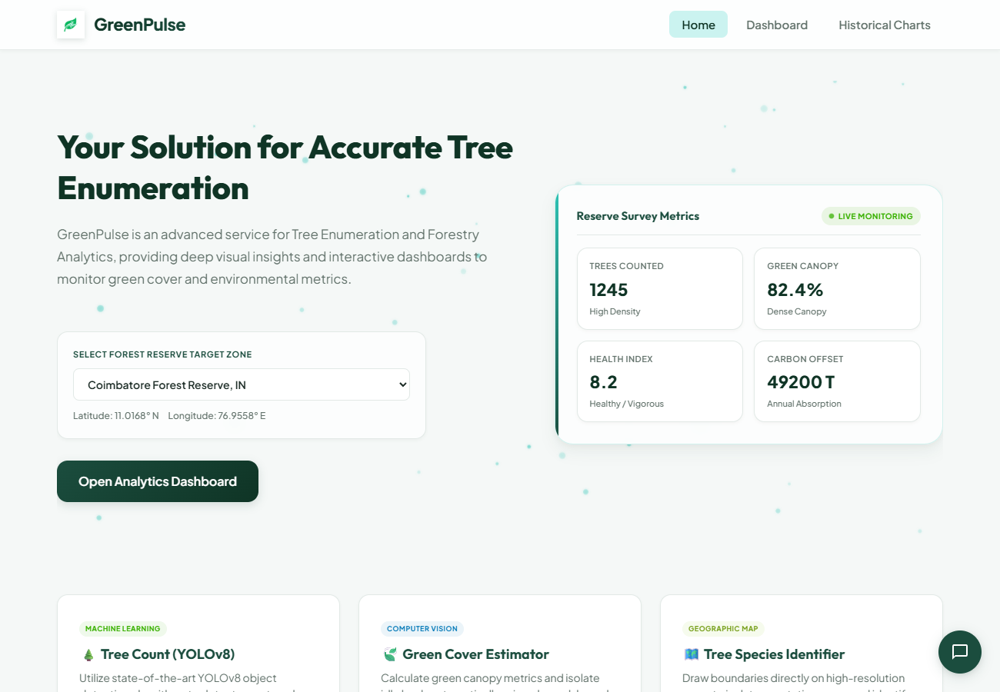
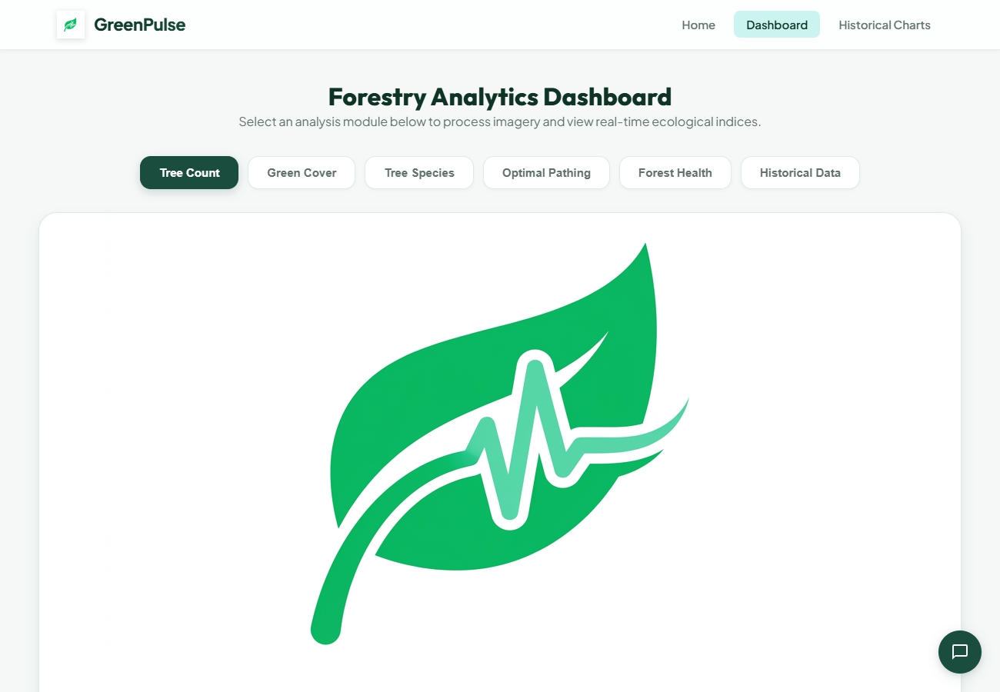
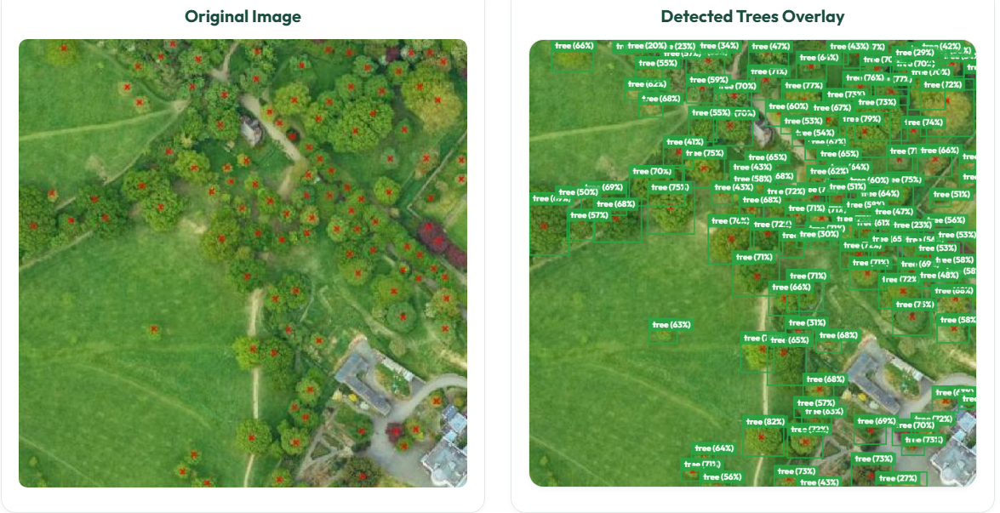
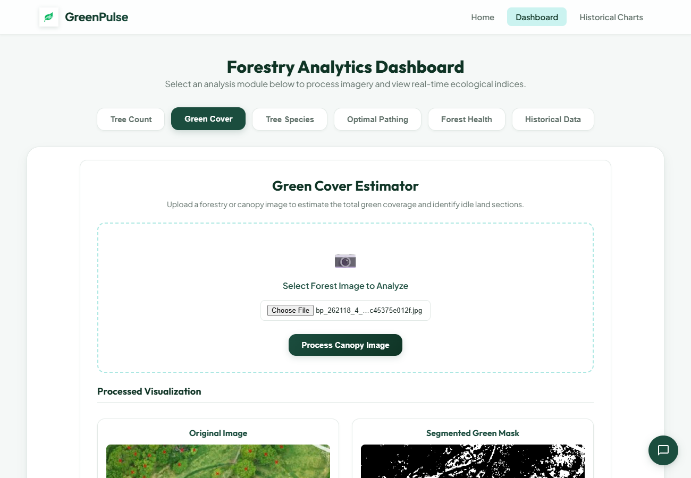
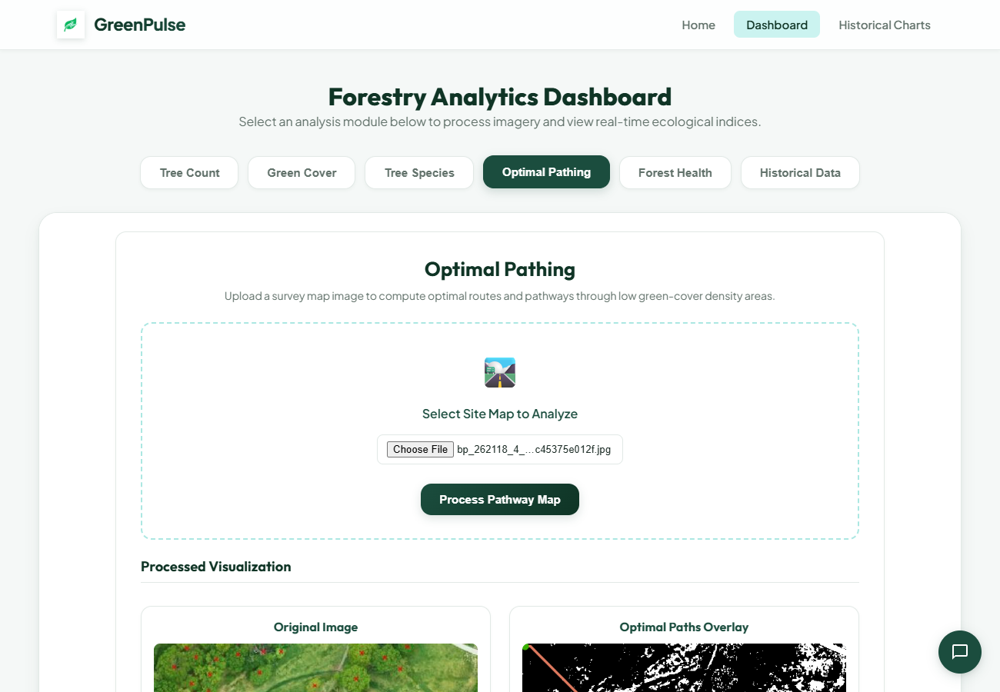
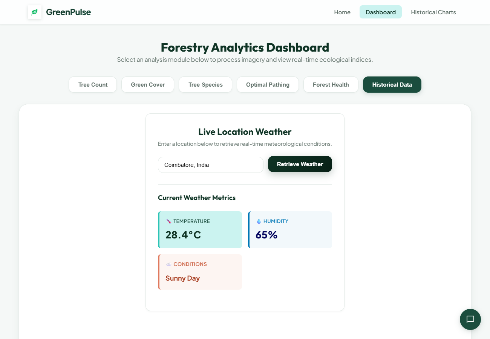
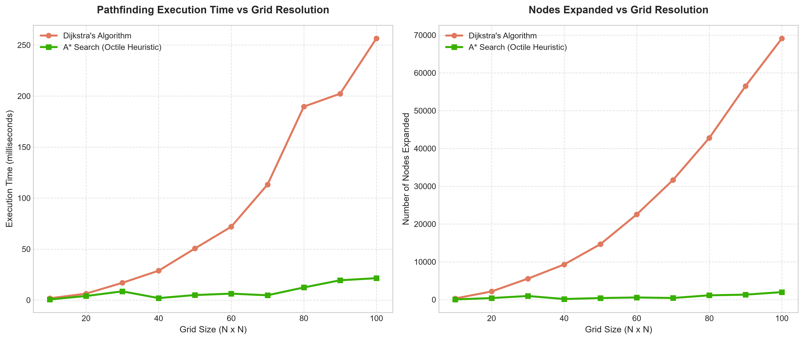

# GreenPulse Imaging

## Image Analytics for Tree Enumeration
The project aims to address the challenge of accurately enumerating trees in forest areas earmarked for diversion due to developmental projects by developing an image analytics system utilizing satellite imagery or aerial photographs to automate tree enumeration. Traditional methods are time-consuming and prone to errors, making it crucial to develop an automated solution.

## Overview
The project includes a website with a landing page and a dashboard offering the following tools:

- **Tree Count:** Allows accurate tree counting within designated forest areas.
- **Green Cover Estimator:** Estimates green cover percentage.
- **Tree Species Identifier:** Identifies tree species.
- **Optimal Pathing:** [Computes the optimal path between two points within the area.](https://github.com/lag25/ForestPathPlanner)
- **Forest Health & Canopy Analyzer:** Evaluates vegetative condition (Healthy, Stressed, Bare Soil) using HSL color analysis and calculates the Forest Health Index (FHI).
- **Historical Data:** Provides historical data for analysis and comparison.

## Features
- Landing Page: Showcases project overview with easy onboarding.
- Dashboard: Offers toggle switches to access various tools.
- Interface: User-friendly interface for easy interaction and exploration of results.
- Integration: Seamless integration with forest management systems.
- Visualization: Generates maps, reports, and visual representations of tree enumeration data.

## Screenshots

## Graph Performance Model

The optimal pathing system uses image segmentation to convert satellite/aerial photography into a binary occupancy grid representing green cover (canopy obstacles) vs open paths.

### 1. Graph Representation
- **Grid Representation**: The site map is modeled as a grid graph $G = (V, E)$.
- **Connectivity**: We support 8-directional diagonal movement (King's moves). For any node $(x, y)$, edges connect to:
  $$\{(x \pm 1, y), (x, y \pm 1), (x \pm 1, y \pm 1)\}$$
- **Edge Cost Equation**:
  The transition cost between neighboring nodes incorporates distance, local pixel values (green canopy vs open soil), and average surrounding density:
  $$\text{Edge Cost} = f(I, \mathbf{u}, \mathbf{v}) = \text{TCD\_FACTOR} \times (255 - I(\mathbf{v})) + d(\mathbf{u}, \mathbf{v}) + 50000 \times \ln(\text{avg\_density} + 1)$$
  where $I(\mathbf{v})$ is the pixel intensity (0 for dark/obstacle canopy, 255 for open areas), $d(\mathbf{u}, \mathbf{v})$ is the movement distance ($1.0$ or $\sqrt{2}$), and $\text{avg\_density}$ is the canopy density in a 20-pixel neighborhood.

### 2. Downsampling Optimization
Running graph pathfinding on a raw high-resolution image (e.g., $800 \times 1400$ px) yields $|V| \approx 1.12 \times 10^6$ nodes. In a single-threaded environment like web-browsers or python, Dijkstra's algorithm would require substantial memory and overhead ($O(|V| \log |V| + |E|)$).
To address this:
- The image is **downsampled** into a coarser $60 \times 60$ block grid.
- Each block's cost is computed by measuring the ratio of canopy (obstacle) pixels to total pixels within the block. If canopy cover exceeds 40%, the block cost is set to a high penalty value ($25$), else it is treated as an open path ($1$).

### 3. Empirical Benchmarks (Dijkstra vs. A*)
Using the downsampled grid, we compare **Dijkstra's Algorithm** (uninformed, uniform-cost search) against **A* Search** using the **Octile Heuristic**:
$$h(x_1, y_1, x_2, y_2) = (dx + dy) + (\sqrt{2} - 2) \times \min(dx, dy)$$
where $dx = |x_1 - x_2|$, $dy = |y_1 - y_2|$.

Below is the performance benchmark across different grid resolutions:

| Grid Size | Dijkstra Time (ms) | Dijkstra Nodes Expanded | A* Time (ms) | A* Nodes Expanded |
| :--- | :--- | :--- | :--- | :--- |
| **10 x 10** | 1.80 ms | 301 | 0.69 ms | 46 |
| **20 x 20** | 6.35 ms | 2,149 | 4.02 ms | 404 |
| **40 x 40** | 28.83 ms | 9,285 | 1.99 ms | 153 |
| **60 x 60** | 71.93 ms | 22,540 | 6.36 ms | 560 |
| **80 x 80** | 189.62 ms | 42,777 | 12.41 ms | 1,131 |
| **100 x 100** | 256.49 ms | 69,127 | 21.48 ms | 1,977 |

*Note: Benchmarks were executed on an occupancy grid with 30% canopy density.*

#### Key Takeaway:
At a $100 \times 100$ grid size, A* runs **11.9x faster** and expands **35x fewer nodes** than Dijkstra, making it optimal for interactive web use.

## Getting Started
To start using the tools, run the project locally (e.g. by starting the server in the `treesense` directory using `npm start`) and navigate to the dashboard.

## Contributions
Contributions are welcome! Please open a PR to get started on contributing to the project.